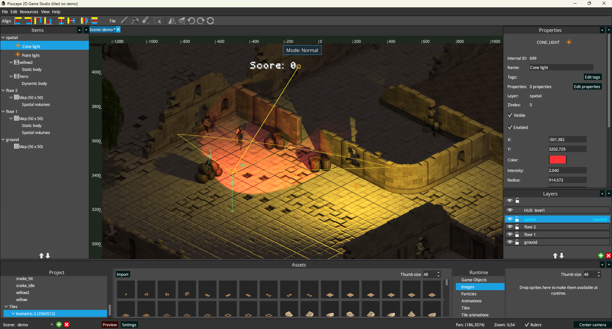

# Pixscape Runtime

[](CHANGELOG.md)<br>
[](https://central.sonatype.com/artifact/games.pixscape/pixscape-runtime)<br>
[](#requirements)<br>
[](LICENSE)<br>

**Bring 2D artwork to life in 2.5D worlds, with Java and LibGDX.**

Pixscape Runtime combines altitude-aware scenery, spatial ordering, dynamic lighting and shadows to give sprites and tiles depth. Load worlds authored in Pixscape Studio and write gameplay in Java, with direct access to LibGDX and Artemis-ODB. Traditional 2D scenes are supported too.

[Documentation](https://pixscape.games/docs) · [Studio Free](https://github.com/pixscapegames/pixscape-studio-free) · [Changelog](CHANGELOG.md)



## What you can build

- **2.5D environments from sprites and tiles:** altitude-aware walls and actors, with Spatial ordering for characters moving in front of and behind scenery.
- **Dynamic lighting:** point and cone lights, cast and received shadows, optional normal maps, and actor silhouettes that turn toward the light.
- **Orthographic and isometric maps:** multiple Tiled maps, animated tiles, layered scenes and native-size artwork.
- **Reusable gameplay objects:** hierarchical Game Objects, runtime spawning, animation clips, particles, tags and typed custom properties.
- **Physics and interfaces:** Box2D bodies, shapes and joints, plus HUD screens authored in Studio.
- **Windows, Linux, macOS, Android and web games:** a shared Runtime with HTML5/WebGL2 support.

## Built for Java developers

Use `PixscapeEngine` and `PixscapeAPI` for scene lifecycle and gameplay. Extend the engine with custom Artemis systems or supported LibGDX and Box2D access when needed.

Rendering uses texture-array batching, culling and cached Tiled preparation. Scene dependencies and resources declared through **Runtime Availability** are prepared before the scene becomes ready, including assets intended for dynamic spawning.

**Legacy** is the default renderer and supports multiple lights. The optional **Forward** renderer is experimental and currently supports at most one active light. Normal maps can be enabled or disabled for the whole scene.

## Get started

Author and export your project with [Pixscape Studio Free](https://pixscape.games/), then add Runtime **0.2.2** to your LibGDX project:

```gradle
repositories {
    mavenCentral()
}

dependencies {
    implementation "games.pixscape:pixscape-runtime:0.2.2"
}
```

[Read the documentation](https://pixscape.games/docs) for setup and gameplay integration. The [API support policy](RUNTIME_API_SUPPORT_POLICY.md) distinguishes high-level APIs, supported expert integration and internal implementation details.

## Requirements

Supported platforms: **Windows, Linux, macOS, Android and HTML5/WebGL2**.

Runtime is published as **Java 8-compatible bytecode**. Rendering targets OpenGL 3 / OpenGL ES 3 / WebGL2; HDR lighting requires renderable, blendable RGBA16F support.

iOS/RoboVM is not currently an officially tested target. Before 1.0, APIs and exported formats can change; check the [changelog](CHANGELOG.md) when upgrading.

<details>
<summary><strong>Build from source</strong></summary>

Use JDK 21 and the included Gradle wrapper:

```sh
./gradlew build
```

On Windows, use `gradlew.bat` instead of `./gradlew`. The build targets Java 8 for the published Runtime classes.

</details>

## License

[Apache License 2.0](LICENSE).
