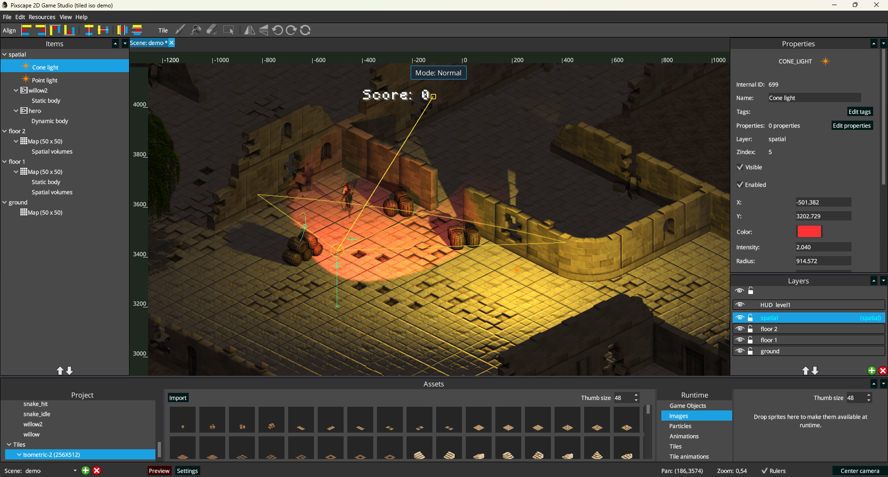

# Pixscape Runtime

[](CHANGELOG.md)<br>
[](https://central.sonatype.com/artifact/games.pixscape/pixscape-runtime)<br>
[](#requirements)<br>
[](LICENSE)<br>

**Bring 2D artwork to life in 2.5D worlds, with Java and LibGDX.**

Pixscape Runtime combines altitude-aware scenery, spatial ordering, dynamic lighting and shadows to give sprites and tiles depth. Load worlds authored in Pixscape Studio and write gameplay in Java, with direct access to LibGDX and Artemis-ODB. Traditional 2D scenes are supported too.

[Documentation](https://pixscape.games/docs) · [Studio Free](https://github.com/pixscapegames/pixscape-studio-free) · [Changelog](CHANGELOG.md)



## What you can build

- **2.5D environments from sprites and tiles:** altitude-aware walls and actors, with Spatial ordering for characters moving in front of and behind scenery.
- **Dynamic lighting:** point and cone lights, cast and received shadows, optional normal maps, and actor silhouettes that turn toward the light.
- **Orthographic and isometric maps:** multiple Tiled maps, animated tiles, layered scenes and native-size artwork.
- **Reusable gameplay objects:** hierarchical Game Objects, runtime spawning, animation clips, particles, tags and typed custom properties.
- **Physics and interfaces:** Box2D bodies, shapes and joints, plus HUD screens authored in Studio.
- **Windows, Linux, macOS, Android and web games:** a shared Runtime with HTML5/WebGL2 support.

## Built for Java developers

Use `PixscapeEngine` and `PixscapeAPI` for scene lifecycle and gameplay. Extend the engine with custom Artemis systems or supported LibGDX and Box2D access when needed.

Rendering uses texture-array batching, culling and cached Tiled preparation. Scene dependencies and resources declared through **Runtime Availability** are prepared before the scene becomes ready, including assets intended for dynamic spawning.

**Legacy** is the default renderer and supports multiple lights. The optional **Forward** renderer is experimental and currently supports at most one active light. Normal maps can be enabled or disabled for the whole scene.

## Get started

Author and export your project with [Pixscape Studio Free](https://pixscape.games/), then add Runtime **0.2.4** to your LibGDX project:

```gradle
repositories {
    mavenCentral()
}

dependencies {
    implementation "games.pixscape:pixscape-runtime:0.2.4"
}
```

[Read the documentation](https://pixscape.games/docs) for setup and gameplay integration. The [API support policy](RUNTIME_API_SUPPORT_POLICY.md) distinguishes high-level APIs, supported expert integration and internal implementation details.

## Find imported objects by layer

After exporting a TMX import from Studio, data-only objects can be queried by
their exact, case-sensitive layer name, without tags or Game Objects:

```java
for (EntityRef point : api.entities().findAllByTiledLayerName("spawn-points")) {
    int role = point.properties().getInt("role", -1);
    float x = point.transform().x();
    float y = point.transform().y();
    // Apply game logic according to role.
}
```

Tiled object-layer lookup returns its direct objects; tile/image-layer lookup
returns their existing content entity. Duplicate names combine contents. Maps
and their layers retain structural ownership and cannot be Game Object assets.
Map/tile transforms support translation only; object/image layers keep their
existing specialized transforms. Structural roles reject actor footprints while
managed tile collisions remain available through `TiledLayerRef.layer()`.

For ordinary scene layers, `findAllByLayerName(...)` remains separate.
Its array is an unordered snapshot of direct `EntityIndexComponent` members
in the current World. Homonymous layers are combined without duplicates;
layer entities and Game Object members are excluded, and no hierarchy is traversed. Null, absent and
empty layers yield an empty array. References do not follow recycled IDs.

The name/member index is built lazily in O(layers + content entities), then
lookups cost O(1 + results). Structural changes invalidate it after ECS
subscription synchronization; layer changes signaled through `DirtyTrackerSystem`
invalidate it independently of rendering's dirty-list consumption. Expert ECS
edits to `LayerNameComponent.name`, `LayerComponent.layerIndex` or
`EntityIndexComponent.layerIndex` must call `dirty.layer(entityId)` afterwards.
Transforms and custom-property edits do not invalidate it. Export again with
the updated Studio to include layer names in Runtime scenes.

## Requirements

Supported platforms: **Windows, Linux, macOS, Android and HTML5/WebGL2**.

Runtime is published as **Java 8-compatible bytecode**. Rendering targets OpenGL 3 / OpenGL ES 3 / WebGL2; HDR lighting requires renderable, blendable RGBA16F support.

iOS/RoboVM is not currently an officially tested target. Before 1.0, APIs and exported formats can change; check the [changelog](CHANGELOG.md) when upgrading.

<details>
<summary><strong>Build from source</strong></summary>

Use JDK 21 and the included Gradle wrapper:

```sh
./gradlew build
```

On Windows, use `gradlew.bat` instead of `./gradlew`. The build targets Java 8 for the published Runtime classes.

</details>

## License

[Apache License 2.0](LICENSE).

## Typed custom properties

`entity.properties()` and `tile.properties()` expose read-only named values. Names are case-sensitive.
Missing scalar properties return the supplied fallback; missing CLASS/LIST/ENUM properties return `null`.
A present value with the wrong type throws `IllegalStateException`; a list index outside `[0, size)` throws
`IndexOutOfBoundsException`. An explicit empty LIST has size zero and differs from absence. Lists retain
individual types, order and duplicates, including nested lists/classes; an empty inherited override replaces
the entire list. Enums retain their definition name, storage type, choices and flags independently of Tiled.

```java
CustomProperties properties = entity.properties();
ListProperty items = properties.getListValue("items");
if (items != null) {
    for (int i = 0; i < items.size(); i++) {
        if (items.typeAt(i) == PropertyType.FLOAT) {
            double exact = items.getDouble(i);
        } else if (items.typeAt(i) == PropertyType.OBJECT) {
            int stableId = items.getObjectStableId(i);
            EntityRef target = api.entities().ofStableId(stableId);
            if (target.exists()) { /* use the resolved target */ }
        }
    }
}
EnumProperty mode = properties.getEnumValue("mode");
if (mode != null && mode.isFlags() && mode.choiceCount() > 0) {
    boolean firstEnabled = mode.isSelected(0);
}
```

FLOAT stores a finite `double`; `getFloat` is an explicit narrowing read and is never an import/copy
intermediate. OBJECT stores a positive stable ID or `-1` (None), never an ECS ID or list index. Resolving a
missing/deleted target returns an unavailable handle; reusing its ECS slot does not retarget the property.
Named and indexed access is O(1), without copying collections. Nested CLASS/LIST/ENUM views belong to the
captured value: reacquire them after replacing the property/component. Entity-backed properties become
empty when their entity handle is stale. Authoring copies and remapping occur at explicit mutation boundaries.
See `ListEnumPropertiesTest`, `CustomPropertiesApiTest` and `GameObjectHierarchySpawnTest` for compiled
examples of simple/mixed/nested lists, enum flags and independent instances.

Current storage formats: scene metadata 8, Game Object 7, tileset profiles 2 (common schema 2/components 8).
Historical formats are rejected; no migration or implicit repair is provided. Studio selects a `.tiled-project`
explicitly when enum definitions are required. External CLASS defaults are not synthesized; missing declared
members are reported. FILE and other unsupported tile metadata retain only their existing IMPORTED contract;
unsupported values inside LIST are rejected with an item path.
